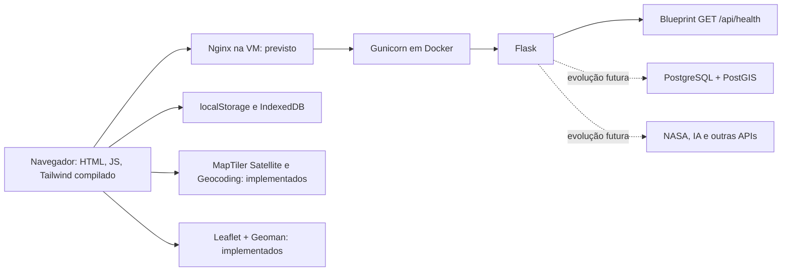

# Arquitetura

O planejamento de cultivos usa POST assíncrono e consultas curtas de andamento para evitar que a pesquisa exceda a espera do proxy. Trabalhos e resultados temporários ficam em SQLite compartilhado entre os workers do mesmo container; threads limitadas executam o Core. O plano escolhido continua no IndexedDB do navegador. Contrato, expiração e limites estão em `docs/PLANEJAMENTO_CULTIVOS.md`.

O Flask serve `app/templates/index.html` em `/`; o CSS e o JavaScript existentes estão incorporados. O navegador mantém dados demonstrativos localmente. A API atual expõe apenas `/api/health`. O simulador de conectividade na interface é independente do backend.

A mini estação usa `POST /api/v1/stations/telemetry` para receber leituras autenticadas por `X-Station-Key` e SQLite em volume Docker persistente. Consultas públicas por ID retornam a última leitura ou um intervalo; o ID padrão no navegador é `agrion-demo-001`. O horário é o de recebimento no servidor (UTC). IDs conhecidos permitem leitura pública, conforme o contrato do MVP. A chave de envio vem de `AGRION_STATION_KEYS` no ambiente da VM e nunca vai ao navegador.

O fluxo de primeiro acesso está em `app/static/property-flow.js`; a persistência isolada está em `app/static/property-store.js`. A geometria é um `Polygon` GeoJSON WGS84, com pares `[longitude, latitude]`. O cálculo de área usa integração geodésica sobre esfera WGS84 aproximada, em m² e hectares. O navegador grava um único registro versionado em `agrion-property-v1`, sem alterar `flora-demo-v3-1` ou o IndexedDB legado. A edição só substitui o registro após confirmação. No futuro, o GeoJSON poderá ser validado no servidor e convertido para `geometry(Polygon, 4326)` no PostGIS; ainda não há API de persistência.

Gunicorn atende na porta 8000 do contêiner. O Compose publica `127.0.0.1:8000` na VM. Nginx existente deverá encaminhar o domínio configurado para esse endereço, preservando HTTPS. A alteração do virtual host exige inspeção e backup antes da validação com `nginx -t`.

`AGRION_LOG_LEVEL` controla o nível de logs; o valor padrão é `INFO`. Gunicorn registra acesso e erros em stdout/stderr; Docker limita a retenção do log. `.env.example` documenta a configuração não secreta. Segredos futuros devem vir do ambiente e nunca ser versionados.

`MAPTILER_API_KEY` chega ao Flask pelo ambiente e é inserida no HTML para o cliente MapTiler. Trata-se de chave pública de navegador, portanto deve ter restrição de origem configurada no painel MapTiler para os endereços locais usados e `https://agrion.earth`. A chave real fica em `.env` local/VM, fora do Git. Se estiver vazia, o mapa mostra uma mensagem e não simula imagens ou localização.

O PostgreSQL com PostGIS será adicionado quando houver necessidade de persistência remota e consultas espaciais no servidor. A geometria real já pode ser desenhada no navegador, mas fica apenas no armazenamento local. Integrações NASA e IA exigirão serviços separados, credenciais seguras, fontes verificáveis e tratamento de indisponibilidade. Esses componentes ainda não estão implementados. A decisão atual prioriza servir o protótipo original com alterações mínimas e um backend modular pequeno.
# Agrion Discovery

O contrato ativo foi simplificado para cultura atual e anterior, com dados numéricos de colheita opcionais. Português usa Orus; inglês usa a voz padrão. A escolha de idioma é permitida antes da primeira resposta. Regras de compatibilidade, preenchimento parcial e testes estão em [Discovery: validação e idioma](DISCOVERY_VALIDACAO_IDIOMA.md).

O cadastro geográfico permanece em `localStorage` e recebe um `propertyId` UUID estável. O perfil agrícola, a entrevista, as revisões e os turnos pendentes ficam em stores separadas do IndexedDB `agrion-discovery`. O perfil não duplica o polígono; o cadastro geográfico segue como fonte de verdade.

`/api/interview/extract` valida a fala e usa `google-genai` com `vertexai=True` e credenciais padrão da VM Compute Engine. `/api/interview/live-session` faz relay WebSocket autenticado no servidor para a Live API do Vertex AI. O navegador não recebe token Google. O endpoint de token efêmero do documento inicial foi substituído por este relay para cumprir a exigência de usar Vertex AI e a service account existente. O proxy HTTPS precisa encaminhar `Upgrade` e `Connection` para o Gunicorn. Não houve alteração de IAM ou faturamento.

Idioma da conversa é configurável; IDs de campos, estados e categorias agrícolas continuam canônicos e não são traduzidos. A ausência de `GOOGLE_CLOUD_PROJECT` ou `GOOGLE_CLOUD_LOCATION` causa erro explícito. O Live usa `us-central1`; a extração usa `GOOGLE_CLOUD_EXTRACTION_LOCATION=us`, porque o modelo textual escolhido não lista `us-central1` para inferência. O limite em memória por processo é apenas proteção inicial contra abuso e não é global entre os workers.
