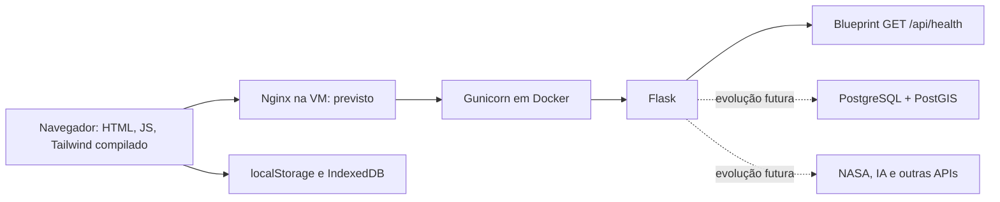

# Arquitetura

O Flask serve `app/templates/index.html` em `/`; o CSS e o JavaScript existentes estão incorporados. O navegador mantém dados demonstrativos localmente. A API atual expõe apenas `/api/health`. O simulador de conectividade na interface é independente do backend.

Gunicorn atende na porta 8000 do contêiner. O Compose publica `127.0.0.1:8000` na VM. Nginx existente deverá encaminhar o domínio configurado para esse endereço, preservando HTTPS. A alteração do virtual host exige inspeção e backup antes da validação com `nginx -t`.

`AGRION_LOG_LEVEL` controla o nível de logs; o valor padrão é `INFO`. Gunicorn registra acesso e erros em stdout/stderr; Docker limita a retenção do log. `.env.example` documenta a configuração não secreta. Segredos futuros devem vir do ambiente e nunca ser versionados.

O PostgreSQL com PostGIS será adicionado quando houver necessidade de persistência remota e geometrias reais. Integrações NASA e IA exigirão serviços separados, credenciais seguras, fontes verificáveis e tratamento de indisponibilidade. Nenhum desses componentes está implementado agora. A decisão atual prioriza servir o protótipo original com alterações mínimas e um backend modular pequeno.
